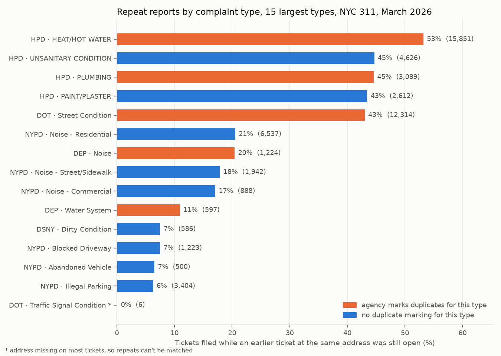

# Data structures in practice: NYC 311 service requests

> **Status: in progress.** Part 1 (hash maps for finding repeat reports) is built, tested and run on a full month of data. Heaps, a sweep line and union-find come next (see [Roadmap](#roadmap)).

**Business question:** a city's 311 line logged **342,390 service requests in March 2026**. Agencies plan crews, inspectors and budgets from ticket counts. But how many tickets are *new problems*, and how many are people reporting a problem that's already on the list? And can an analyst answer that on a laptop in seconds instead of hours?

This repo applies everyday data structures (the ones behind Python's `dict`, `heapq` and `bisect`) to real operational data. Each part pairs a **naive version** with a **better data structure**, checks that both give the same answer, times them, and then uses the fast one to answer a business question.

## Part 1: repeat reports with a hash map

### The rule
A ticket is a **repeat** when an earlier ticket with the same **agency + complaint type + address** was **still open** when it came in. (A 24-hour-window variant is also reported.) Tickets with no address can't be matched, so they never count as repeats.

### The data structure
| Version | How it works | Cost |
|---|---|---|
| Naive (`find_repeats_naive`) | For each ticket, scan every earlier ticket for the same key | O(n²) comparisons |
| Hash map (`find_repeats_indexed`) | Keep a `dict` from key → **latest closing time seen so far**. A new ticket is a repeat exactly when that time is later than its own created time | O(n): one lookup per ticket |

Storing one number per key is enough because "is *any* earlier ticket still open?" is the same question as "is the *latest* closing time still in the future?". The tests include the case that breaks simpler shortcuts: a long-running ticket followed by short ones that close quickly.

### Benchmark
From [`results/benchmarks.md`](results/benchmarks.md) (both versions returned identical answers at every size):


- On the first **32,000 tickets**, the naive scan took **88 s** and the hash map **31 ms**.
- On all **319,508 tickets with an address**, the hash map took **0.26 s**. The naive scan would take about **2.4 hours** (extrapolated as n² from the 32,000-ticket run; not run). Timings on this shared VM vary from run to run (three runs gave 60–88 s for the naive scan at 32,000 tickets), but the hash map was 2,900–4,800× faster at that size every time.
- **So what:** a check that runs in a quarter of a second can run at intake, every time a ticket comes in. A check that takes hours can only be a monthly report.

### Does the rule match what agencies call a duplicate?
Three agencies (DOT, HPD, DEP) write "duplicate" in the resolution text for some complaint types. That gives a reference to check the rule against. From [`results/repeat_reports.md`](results/repeat_reports.md):

| Agency · complaint type | Agency's duplicate flags | Rule finds | Notes |
|---|---:|---:|---|
| HPD · Heat/hot water | 8,126 | **97.5%** | the rule matches HPD's own process almost exactly |
| HPD · Plumbing | 363 | 95.0% | |
| DOT · Street condition (potholes etc.) | 9,787 | 56.8% | 3,736 flags are on tickets with no address; of the 6,051 that have one, the rule finds **91.9%** |
| DEP · Water system | 2,247 | 22.8% | one water-main break is reported from many nearby addresses, so an exact-address rule misses most of them (Part 4 will use location) |

Precision is lower (HPD heat: 50.0% of the rule's repeats carry HPD's flag) because the rule finds repeats the agency **didn't** mark. For HPD heat that's 7,930 tickets, and the most common resolution texts show they were worked as separate jobs: 3,040 say HPD "conducted or attempted to conduct" an inspection, 1,381 that it contacted a tenant, 862 that it phoned the number on file. Some will be genuinely separate problems (a different apartment in the same building), so this is an upper bound on avoidable work, not a measured saving.

### Findings


- **One ticket in five is a repeat.** 72,098 of 342,390 tickets (21.1%) arrived while an earlier ticket for the same thing at the same address was still open. March's ticket count overstates distinct open issues by that much (270,292 distinct).
- **Heat complaints are mostly repeats.** 53.2% of HPD's 29,783 heat/hot-water tickets came in while the building already had an open one. HPD's other big categories are close behind (unsanitary 44.7%, plumbing 44.6%, paint/plaster 43.4%), but HPD marks no duplicates at all for unsanitary or paint/plaster complaints.
- **NYPD marks no duplicates at all,** but 15,646 of its 139,705 tickets (11.2%) are repeats by this rule, led by residential noise (6,537, 20.5%). A dashboard of NYPD 311 volume counts the same party several times.
- **DOT can't dedupe what it can't locate:** 31% of street-condition tickets (8,877 of 28,629) have no street address.

**What this means for the business:**
1. **Report distinct issues next to ticket counts.** Staffing and performance dashboards built on raw counts treat every repeat as new demand: about one ticket in five overall, and more than half of heat tickets, repeat an issue that's already open.
2. **Link repeats at intake.** The hash-map check is cheap enough to run on every new ticket: attach it to the open ticket and tell the caller it's already logged. That's how HPD handles 8,126 heat tickets already; the same check would cover its unsanitary and paint/plaster complaints and NYPD's noise calls.
3. **Treat repeat counts as a signal, not noise.** An address that keeps generating repeats is a persistent problem (no heat, a noisy venue). Part 2 ranks those hot spots.

## Data
[NYC Open Data: 311 Service Requests from 2010 to Present](https://data.cityofnewyork.us/d/erm2-nwe9), published by the City of New York. Use is governed by the [NYC Open Data Terms of Use](https://opendata.cityofnewyork.us/overview/#termsofuse). `scripts/download_data.py` fetches every request **created in March 2026** (13 columns, 342,390 rows, ~20 MB gzipped) from the keyless Socrata API, in a fixed order, and checks the server's row count.

The dataset is live: agencies keep closing tickets and editing resolution text. The results here use the snapshot downloaded on **2026-10-11** (SHA-256 `6ae13839c0c9f1ce…`, pinned in `data/raw/source.json`). A fresh download will differ slightly. Raw and processed files aren't committed.

Data-quality checks are in [`results/prep_log.md`](results/prep_log.md): `unique_key` is unique; 3.3% of tickets were still open at download; 3.3% were closed in the same second they were created; 28 were "closed" before they were created (kept, never treated as open); 6.7% have no address.

## Limitations (so far)
- **Exact address match only.** "1 MAIN ST" and "1 MAIN STREET" don't match, and nearby addresses (water-main breaks, street conditions) don't link. Part 4 adds location-based matching.
- **One month.** Issues first reported in late February aren't in the data, so repeats in early March are slightly undercounted.
- **The agency flag is a reference, not ground truth.** Agencies use it for some complaint types only, and their rules aren't published.
- **Descriptor isn't in the key.** Two different heat problems at one address (apartment vs whole building) count as one issue.

## How to run
```bash
uv venv && source .venv/bin/activate        # or python -m venv .venv
uv pip install -r requirements.txt           # or pip install -r requirements.txt
python scripts/download_data.py              # ~20 MB → data/raw/ (+ source.json)
python scripts/prepare.py                    # → data/processed/tickets.parquet + results/prep_log.md
python scripts/repeat_reports.py             # → results/repeat_reports.md, .csv, chart 01
python scripts/benchmark.py                  # ~2 min → results/benchmarks.md, .csv, chart 02
pytest                                       # 11 offline tests
```

## Repo layout
```
dsa/repeats.py              naive and hash-map repeat finders (pure Python, no pandas)
scripts/download_data.py    fetch March 2026 from the NYC Open Data API
scripts/prepare.py          parse, normalise addresses, data-quality log
scripts/repeat_reports.py   Part 1 analysis
scripts/benchmark.py        naive vs hash map timings
tests/                      unit tests (hand-made cases + naive == indexed on random data)
results/                    generated reports, CSVs and charts
```

## Roadmap
- **Part 2: heaps for top-k.** The addresses generating the most repeats per agency, computed in one streaming pass with `heapq` (O(n log k)) vs sorting everything.
- **Part 3: a sweep line for backlog.** Peak number of open tickets per agency over the month (the staffing question), from sorted open/close events vs checking every hour against every ticket.
- **Part 4: union-find and spatial hashing.** Group reports of one incident from nearby addresses (water-main breaks, potholes on one block) and re-check DEP's water-system flags.
- Then: final recommendations, limitations, and the finished write-up.
