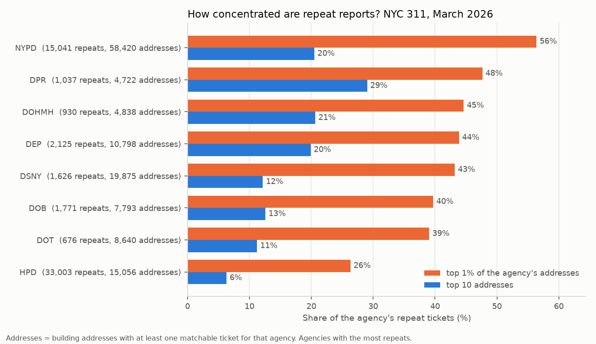

# Data structures in practice: NYC 311 service requests

> **Status: in progress.** Part 1 (hash maps for finding repeat reports) and the analysis half of Part 2 (heaps for ranking repeat hot spots) are built, tested and run on a full month of data. The Part 2 benchmark, a sweep line and union-find come next (see [Roadmap](#roadmap)).

**Business question:** a city's 311 line logged **342,390 service requests in March 2026**. Agencies plan crews, inspectors and budgets from ticket counts. But how many tickets are *new problems*, and how many are people reporting a problem that's already on the list? And can an analyst answer that on a laptop in seconds instead of hours?

This repo applies everyday data structures (the ones behind Python's `dict`, `heapq` and `bisect`) to real operational data. Each part pairs a **naive version** with a **better data structure**, checks that both give the same answer, times them, and then uses the fast one to answer a business question.

## Part 1: repeat reports with a hash map

### The rule
A ticket is a **repeat** when an earlier ticket with the same **agency + complaint type + building address** (house number, street and borough) was **still open** when it came in. (A 24-hour-window variant is also reported.) Tickets with no address, no borough, or only a street name ("BROADWAY", which 311 uses for most road problems) can't be matched, so they never count as repeats. That's 15.4% of tickets.

> **Correction (2026-10-11).** The first version of Part 1, published earlier the same day, matched on the address text alone. A bare street name like "BROADWAY" then counted as one place across the whole city, and the same address in two boroughs counted as one place. The key now needs a house number and includes the borough. Repeats fell from 72,098 (21.1%) to 57,948 (16.9%). Most of the drop (11,927 of 14,150) is DOT street conditions, and the earlier claim that the rule matches 91.9% of DOT's duplicate flags is **withdrawn**: those matches were on street names, not places. HPD's repeats are unchanged to within 5 tickets; NYPD's fell 4% (15,646 → 15,041).

### The data structure
| Version | How it works | Cost |
|---|---|---|
| Naive (`find_repeats_naive`) | For each ticket, scan every earlier ticket for the same key | O(n²) comparisons |
| Hash map (`find_repeats_indexed`) | Keep a `dict` from key → **latest closing time seen so far**. A new ticket is a repeat exactly when that time is later than its own created time | O(n): one lookup per ticket |

Storing one number per key is enough because "is *any* earlier ticket still open?" is the same question as "is the *latest* closing time still in the future?". The tests include the case that breaks simpler shortcuts: a long-running ticket followed by short ones that close quickly.

### Benchmark
From [`results/benchmarks.md`](results/benchmarks.md) (both versions returned identical answers at every size):


- On the first **32,000 tickets**, the naive scan took **62 s** and the hash map **15 ms**.
- On all **289,640 tickets with a building address**, the hash map took **0.23 s**. The naive scan would take about **1.4 hours** (extrapolated as n² from the 32,000-ticket run; not run). Timings on this shared VM vary from run to run: the hash map was about 4,200× faster at 32,000 tickets in this run, and 2,900–4,800× in three earlier runs with the first version of the key.
- **So what:** a check that runs in a quarter of a second can run at intake, every time a ticket comes in. A check that takes hours can only be a monthly report.

### Does the rule match what agencies call a duplicate?
Three agencies (DOT, HPD, DEP) write "duplicate" in the resolution text for some complaint types. That gives a reference to check the rule against. From [`results/repeat_reports.md`](results/repeat_reports.md):

| Agency · complaint type | Agency's duplicate flags | Rule finds | Notes |
|---|---:|---:|---|
| HPD · Heat/hot water | 8,126 | **97.5%** | the rule matches HPD's own process almost exactly |
| HPD · Plumbing | 363 | 95.0% | |
| DEP · Water system | 2,247 | 22.7% | one water-main break is reported from many nearby addresses, so an exact-address rule misses most of them (Part 4 will use location) |
| DOT · Street condition (potholes etc.) | 9,787 | 0.1% | can't be checked by address: only 32 of DOT's flags are on tickets with a building address. DOT records road problems by street name or not at all (Part 4 will use location) |

Precision is lower (HPD heat: 50.0% of the rule's repeats carry HPD's flag) because the rule finds repeats the agency **didn't** mark. For HPD heat that's 7,927 tickets, and the most common resolution texts show they were worked as separate jobs: 3,040 say HPD "conducted or attempted to conduct" an inspection, 1,381 that it contacted a tenant, 861 that it phoned the number on file. Some will be genuinely separate problems (a different apartment in the same building), so this is an upper bound on avoidable work, not a measured saving.

### Findings


- **One ticket in six is a repeat.** 57,948 of 342,390 tickets (16.9%) arrived while an earlier ticket for the same thing at the same building was still open. March's ticket count overstates distinct issues by that much (284,442 distinct). This is a floor: the 15.4% of tickets with no building address can't be checked.
- **Heat complaints are mostly repeats.** 53.2% of HPD's 29,783 heat/hot-water tickets came in while the building already had an open one. HPD's other big categories are close behind (unsanitary 44.7%, plumbing 44.6%, paint/plaster 43.4%), but HPD marks no duplicates at all for unsanitary or paint/plaster complaints.
- **NYPD marks no duplicates at all,** but 15,041 of its 139,705 tickets (10.8%) are repeats by this rule, led by residential noise (6,527, 20.5%). A dashboard of NYPD 311 volume counts the same party several times.
- **DOT can't dedupe by address:** only 3,973 of its 28,629 street-condition tickets (13.9%) have a building address; the rest give a street name or nothing. Its duplicates need a location-based check (Part 4).

**What this means for the business:**
1. **Report distinct issues next to ticket counts.** Staffing and performance dashboards built on raw counts treat every repeat as new demand: about one ticket in six overall, and more than half of heat tickets, repeat an issue that's already open.
2. **Link repeats at intake.** The hash-map check is cheap enough to run on every new ticket: attach it to the open ticket and tell the caller it's already logged. That's how HPD handles 8,126 heat tickets already; the same check would cover its unsanitary and paint/plaster complaints and NYPD's noise calls.
3. **Treat repeat counts as a signal, not noise.** An address that keeps generating repeats is a persistent problem (no heat, a noisy venue). Part 2 ranks those hot spots.

## Part 2: repeat hot spots with heaps (top-k)

Part 1 counted repeats. The next question is *where* they come from: if a few addresses produce most of the repeat calls, an agency can deal with those places once instead of answering every call.

### The data structure
Repeats are counted per agency and building with a `dict` (Part 1's tool again). Picking the top addresses from those counts is a **top-k** problem:

| Version | How it works | Cost |
|---|---|---|
| Sort (`top_k_sort`) | Sort every address by repeat count, keep the first k | O(n log n) time, holds all n |
| Bounded heap (`top_k_heap`) | Keep a min-heap of the best k so far. Its root is the weakest of them, so a new address only gets in if it beats the root | O(n log k) time, holds only k |
| Heap per group (`top_k_per_group`) | One heap per agency in a dict, filled in a single pass | O(n log k) time, holds agencies × k |

Ties go to the address whose first repeat came earlier, so the heap returns exactly the list that sorting returns. The tests check this against `sorted()` and the standard library's `heapq.nlargest` on random data full of ties. A timing and memory benchmark against both is the next step.

### Findings
From [`results/hot_spots.md`](results/hot_spots.md). House numbers are left out of every output in this repo: the 311 data is public, but the business point doesn't need to identify single homes.



- **NYPD's repeat calls come from a small number of places.** 1% of the addresses with an NYPD ticket (585 of 58,420) produced **56.4%** of its repeats (8,483 of 15,041). One Bronx building alone produced 1,526 repeats, **10.1% of all NYPD repeats**, from 1,596 noise tickets (almost all "loud music/party") on 9 days in March.
- **Every other large agency is concentrated too.** The top 1% of addresses produced 39–48% of repeats at DOT, DOB, DSNY, DEP, DOHMH and DPR. HPD is the most spread out: its top 1% (151 buildings) produced 26.3% of its 33,003 repeats, so its repeat work comes from many buildings. Its top building had 461 repeats from 471 heat tickets over 22 days.
- **Some buildings are a problem for several agencies at once.** 113 buildings had repeat tickets for 3 or more agencies. The second-largest is one Bronx building on Woodycrest Avenue with 315 repeats across 5 agencies: HPD 216, DSNY 60, DOB 24, DOHMH 11 and NYPD 4. The most common complaint there for each agency tells one story: garbage storage (HPD), trash (DSNY), boilers (DOB), rats (DOHMH). Each agency sees only its own part.
- **Repeats undercount chronic places.** One Brooklyn address had 746 residential noise tickets (almost all "banging/pounding"), with at least one every day of March, but only 325 count as repeats: the other 421 arrived when no earlier ticket there was still open. "Still open" measures duplicate work; "days with a ticket" measures a chronic problem. Both columns are in the report.

**What this means for the business:**
1. **Manage the top 1% as cases, not tickets.** For NYPD, 585 addresses drive more than half of repeat calls. One owner and one plan per chronic location (a single coordinated visit, a call to the building's management) can replace dozens of separate responses to the same place.
2. **Share a cross-agency hot-spot list.** A building that shows up as garbage, boiler and rat complaints in four different queues is probably one management problem. The 113 multi-agency buildings are a short list for a joint inspection.
3. **Track chronic locations by days with a ticket, as well as by repeats.** An address that's reported every day but closed every time never looks like a duplicate.

## Data
[NYC Open Data: 311 Service Requests from 2010 to Present](https://data.cityofnewyork.us/d/erm2-nwe9), published by the City of New York. Use is governed by the [NYC Open Data Terms of Use](https://opendata.cityofnewyork.us/overview/#termsofuse). `scripts/download_data.py` fetches every request **created in March 2026** (13 columns, 342,390 rows, ~20 MB gzipped) from the keyless Socrata API, in a fixed order, and checks the server's row count.

The dataset is live: agencies keep closing tickets and editing resolution text. The results here use the snapshot downloaded on **2026-10-11** (SHA-256 `6ae13839c0c9f1ce…`, pinned in `data/raw/source.json`). A fresh download will differ slightly. Raw and processed files aren't committed.

Data-quality checks are in [`results/prep_log.md`](results/prep_log.md): `unique_key` is unique; 3.3% of tickets were still open at download; 3.3% were closed in the same second they were created; 28 were "closed" before they were created (kept, never treated as open); 6.7% have no address and 8.7% give only a street name.

## Limitations (so far)
- **Exact building-address match only.** "1 MAIN ST" and "1 MAIN STREET" don't match, nearby addresses (water-main breaks) don't link, and street-name-only tickets (most of DOT's) aren't checked at all. Part 4 adds location-based matching.
- **One month.** Issues first reported in late February aren't in the data, so repeats in early March are slightly undercounted.
- **The agency flag is a reference, not ground truth.** Agencies use it for some complaint types only, and their rules aren't published.
- **Tickets, not people.** The data has no caller ID, so one persistent caller and many neighbours look the same. A hot spot is a place that generates work, not proof of a widespread problem.
- **Descriptor isn't in the key.** Two different heat problems at one address (apartment vs whole building) count as one issue.

## How to run
```bash
uv venv && source .venv/bin/activate        # or python -m venv .venv
uv pip install -r requirements.txt           # or pip install -r requirements.txt
python scripts/download_data.py              # ~20 MB → data/raw/ (+ source.json)
python scripts/prepare.py                    # → data/processed/tickets.parquet + results/prep_log.md
python scripts/repeat_reports.py             # → results/repeat_reports.md, .csv, chart 01
python scripts/benchmark.py                  # ~2 min → results/benchmarks.md, .csv, chart 02
python scripts/hot_spots.py                  # → results/hot_spots.md, .csv, chart 03
pytest                                       # 41 offline tests
```

## Repo layout
```
dsa/repeats.py              naive and hash-map repeat finders, building-address key (pure Python)
dsa/topk.py                 sort vs bounded-heap top-k, overall and per group (pure Python)
scripts/download_data.py    fetch March 2026 from the NYC Open Data API
scripts/prepare.py          parse, normalise addresses, data-quality log
scripts/repeat_reports.py   Part 1 analysis
scripts/benchmark.py        naive vs hash map timings
scripts/hot_spots.py        Part 2 analysis
tests/                      unit tests (hand-made cases + naive == indexed on random data)
results/                    generated reports, CSVs and charts
```

## Roadmap
- **Part 2: heaps for top-k.** ~~Hot spots per agency~~ (done). Next: benchmark the heap against sorting and `heapq.nlargest`, for both time and memory, at several sizes of n and k.
- **Part 3: a sweep line for backlog.** Peak number of open tickets per agency over the month (the staffing question), from sorted open/close events vs checking every hour against every ticket.
- **Part 4: union-find and spatial hashing.** Group reports of one incident from nearby addresses (water-main breaks, potholes on one block) and re-check DEP's water-system flags.
- Then: final recommendations, limitations, and the finished write-up.
