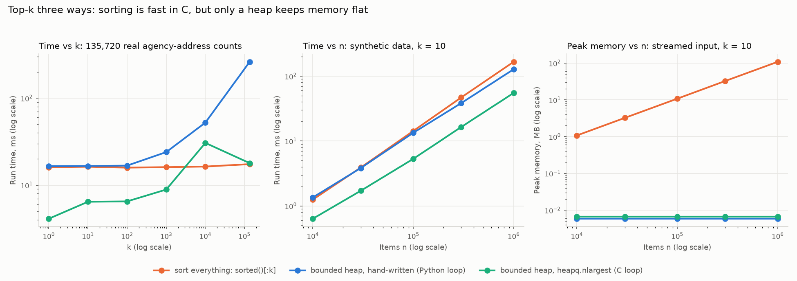

# Data structures in practice: NYC 311 service requests

> **Status: complete.** Four parts (hash maps, heaps, a sweep line, spatial hashing + union-find), each built, tested (109 offline tests), benchmarked and run on a full month of NYC 311 data. [Recommendations](#recommendations) and [limitations](#limitations) are at the end.

**Business question:** a city's 311 line logged **342,390 service requests in March 2026**. Agencies plan crews, inspectors and budgets from ticket counts. But how many tickets are *new problems*, and how many are people reporting a problem that's already on the list? And can an analyst answer that on a laptop in seconds instead of hours?

This repo applies everyday data structures (the ones behind Python's `dict`, `heapq` and `bisect`) to real operational data. Each part pairs a **naive version** with a **better data structure**, checks that both give the same answer, times them, and then uses the fast one to answer a business question.

## TL;DR
- **One ticket in six is a repeat.** 57,948 of 342,390 tickets (16.9%) came in while an earlier ticket for the same thing at the same building was still open, and so did 53.2% of HPD's heat/hot-water tickets. A hash-map check finds 97.5% of HPD's own heat duplicate flags and covers the month in 0.23 s, against about 1.4 hours for the naive scan.
- **Repeats come from a few places.** 1% of NYPD's addresses produced 56.4% of its repeats; one Bronx building alone produced 10.1%. 113 buildings had repeats for 3 or more agencies, each agency seeing only its own part.
- **NYPD's open queue peaks at midnight, two hours after the calls do,** and Sunday and Monday night tickets stayed open 27–32% longer than Saturday's on average (every Sunday and Monday night in March was slower than every Tuesday-to-Saturday night). An hourly snapshot understated the month's peak by 6.2%; a 15-minute one by 0.6%.
- **Location finds what the address can't.** Linking tickets within 100 m finds 66.8% of DEP's water duplicate flags (exact address: 23.3%), and 25 m finds 75.6% of DOT's pothole flags (0.1%). Mapped water and pothole tickets are about 36% fewer incidents than tickets. But 58% of pothole tickets have no coordinates at all.
- **Engineering lesson:** the right data structure turns hours into seconds. Among the fast versions, library code (`heapq.nlargest`, numpy, scipy) beat hand-written Python every time the whole dataset was in memory. The hand-written heap and union-find earned their place on streams and running counts: about 6 kB instead of 108 MB, and 601 ms instead of about 1.1 hours.

## Part 1: repeat reports with a hash map

### The rule
A ticket is a **repeat** when an earlier ticket with the same **agency + complaint type + building address** (house number, street and borough) was **still open** when it came in. (A 24-hour-window variant is also reported.) Tickets with no address, no borough, or only a street name ("BROADWAY", which 311 uses for most road problems) can't be matched, so they never count as repeats. That's 15.4% of tickets.

> **Correction (2026-10-11).** The first version of Part 1, published earlier the same day, matched on the address text alone. A bare street name like "BROADWAY" then counted as one place across the whole city, and the same address in two boroughs counted as one place. The key now needs a house number and includes the borough. Repeats fell from 72,098 (21.1%) to 57,948 (16.9%). Most of the drop (11,927 of 14,150) is DOT street conditions, and the earlier claim that the rule matches 91.9% of DOT's duplicate flags is **withdrawn**: those matches were on street names, not places. HPD's repeats are unchanged to within 5 tickets; NYPD's fell 4% (15,646 → 15,041).

### The data structure
| Version | How it works | Cost |
|---|---|---|
| Naive (`find_repeats_naive`) | For each ticket, scan every earlier ticket for the same key | O(n²) comparisons |
| Hash map (`find_repeats_indexed`) | Keep a `dict` from key → **latest closing time seen so far**. A new ticket is a repeat exactly when that time is later than its own created time | O(n): one lookup per ticket |

Storing one number per key is enough because "is *any* earlier ticket still open?" is the same question as "is the *latest* closing time still in the future?". The tests include the case that breaks simpler shortcuts: a long-running ticket followed by short ones that close quickly.

### Benchmark
From [`results/benchmarks.md`](results/benchmarks.md) (both versions returned identical answers at every size):


- On the first **32,000 tickets**, the naive scan took **62 s** and the hash map **15 ms**.
- On all **289,640 tickets with a building address**, the hash map took **0.23 s**. The naive scan would take about **1.4 hours** (extrapolated as n² from the 32,000-ticket run; not run). Timings on this shared VM vary from run to run: the hash map was about 4,200× faster at 32,000 tickets in this run, and 2,900–4,800× in three earlier runs with the first version of the key.
- **So what:** a check that runs in a quarter of a second can run at intake, every time a ticket comes in. A check that takes hours can only be a monthly report.

### Does the rule match what agencies call a duplicate?
Three agencies (DOT, HPD, DEP) write "duplicate" in the resolution text for some complaint types. That gives a reference to check the rule against. From [`results/repeat_reports.md`](results/repeat_reports.md):

| Agency · complaint type | Agency's duplicate flags | Rule finds | Notes |
|---|---:|---:|---|
| HPD · Heat/hot water | 8,126 | **97.5%** | the rule matches HPD's own process almost exactly |
| HPD · Plumbing | 363 | 95.0% | |
| DEP · Water system | 2,247 | 22.7% | one water-main break is reported from many nearby addresses, so an exact-address rule misses most of them ([Part 4](#part-4-one-incident-many-reports-spatial-hashing--union-find) matches by location: 66.8% at 100 m, on mapped tickets) |
| DOT · Street condition (potholes etc.) | 9,787 | 0.1% | can't be checked by address: only 32 of DOT's flags are on tickets with a building address. DOT records road problems by street name or not at all ([Part 4](#part-4-one-incident-many-reports-spatial-hashing--union-find) matches potholes by location: 75.6% at 25 m, on mapped tickets) |

Precision is lower (HPD heat: 50.0% of the rule's repeats carry HPD's flag) because the rule finds repeats the agency **didn't** mark. For HPD heat that's 7,927 tickets, and the most common resolution texts show they were worked as separate jobs: 3,040 say HPD "conducted or attempted to conduct" an inspection, 1,381 that it contacted a tenant, 861 that it phoned the number on file. Some will be genuinely separate problems (a different apartment in the same building), so this is an upper bound on avoidable work, not a measured saving.

### Findings


- **One ticket in six is a repeat.** 57,948 of 342,390 tickets (16.9%) arrived while an earlier ticket for the same thing at the same building was still open. March's ticket count overstates distinct issues by that much (284,442 distinct). This is a floor: the 15.4% of tickets with no building address can't be checked.
- **Heat complaints are mostly repeats.** 53.2% of HPD's 29,783 heat/hot-water tickets came in while the building already had an open one. HPD's other big categories are close behind (unsanitary 44.7%, plumbing 44.6%, paint/plaster 43.4%), but HPD marks no duplicates at all for unsanitary or paint/plaster complaints.
- **NYPD marks no duplicates at all,** but 15,041 of its 139,705 tickets (10.8%) are repeats by this rule, led by residential noise (6,527, 20.5%). A dashboard of NYPD 311 volume counts the same party several times.
- **DOT can't dedupe by address:** only 3,973 of its 28,629 street-condition tickets (13.9%) have a building address; the rest give a street name or nothing. Its duplicates need a location-based check (Part 4).

**What this means for the business:**
1. **Report distinct issues next to ticket counts.** Staffing and performance dashboards built on raw counts treat every repeat as new demand: about one ticket in six overall, and more than half of heat tickets, repeat an issue that's already open.
2. **Link repeats at intake.** The hash-map check is cheap enough to run on every new ticket: attach it to the open ticket and tell the caller it's already logged. That's how HPD handles 8,126 heat tickets already; the same check would cover its unsanitary and paint/plaster complaints and NYPD's noise calls.
3. **Treat repeat counts as a signal, not noise.** An address that keeps generating repeats is a persistent problem (no heat, a noisy venue). Part 2 ranks those hot spots.

## Part 2: repeat hot spots with heaps (top-k)

Part 1 counted repeats. The next question is *where* they come from: if a few addresses produce most of the repeat calls, an agency can deal with those places once instead of answering every call.

### The data structure
Repeats are counted per agency and building with a `dict` (Part 1's tool again). Picking the top addresses from those counts is a **top-k** problem:

| Version | How it works | Cost |
|---|---|---|
| Sort (`top_k_sort`) | Sort every address by repeat count, keep the first k | O(n log n) time, holds all n |
| Bounded heap (`top_k_heap`) | Keep a min-heap of the best k so far. Its root is the weakest of them, so a new address only gets in if it beats the root | O(n log k) time, holds only k |
| Heap per group (`top_k_per_group`) | One heap per agency in a dict, filled in a single pass | O(n log k) time, holds agencies × k |

Ties go to the address whose first repeat came earlier, so the heap returns exactly the list that sorting returns. The tests check this against `sorted()` and the standard library's `heapq.nlargest` on random data full of ties.

### Benchmark: is the heap actually faster?
From [`results/benchmarks_topk.md`](results/benchmarks_topk.md). Three versions, which returned identical lists in every test: sorting everything (`sorted()`, written in C), the hand-written heap above (a Python loop), and `heapq.nlargest` (the same heap algorithm, with its loop in C). Time is measured on lists already in memory; peak memory is measured with `tracemalloc` while each version reads a **stream** of items made one at a time.



| Test | Sort | Hand-written heap | `heapq.nlargest` |
|---|---:|---:|---:|
| Top 10 of 135,720 real agency-address counts | 16.3 ms | 16.6 ms | **6.4 ms** |
| Top 10,000 of the same | **16.4 ms** | 52.4 ms | 30.6 ms |
| Top 10 of 1,000,000 synthetic items | 166.7 ms | 128.1 ms | **55.2 ms** |
| Peak memory, top 10 of a 1,000,000-item stream | 108.25 MB | **5.9 kB** | 6.6 kB |
| Top 10 per agency, 135,720 rows (16 agencies) | 61.9 ms (sort each agency) | 36.7 ms (heap per agency) | 29.0 ms (pandas, from a DataFrame) |

- **The textbook speed-up mostly doesn't show up in Python.** O(n log k) beats O(n log n) on paper, but the hand-written heap only matches the C sort on the real counts at small k, and is about 1.3× faster at a million items. The heap's loop runs in Python, and `sorted()` runs in C.
- **The same algorithm in C wins.** `heapq.nlargest` was 2.5× faster than sorting for the top 10 of the real counts, and 3× faster at a million items.
- **For large k, just sort.** Both heaps slow down as k grows: from k = 1,000 (about 0.7% of the items) the hand-written heap is slower than sorting, and at k = 10,000 so is `nlargest`. (At k = all, `nlargest` notices and calls `sorted()` itself.)
- **Memory is where the heap really wins.** Sorting a stream means holding all of it: 108 MB for a million items, growing in step with n. Both heaps held 6–7 kB at every size from 10,000 to 1,000,000 items. A top-k over a feed or a file too big for memory works with a heap and doesn't work with a sort.
- **Grouped top-k:** one heap per agency was 1.7× faster than sorting each agency's list. If the data is already in a pandas DataFrame, `sort_values().groupby().head()` was quicker still (29 ms, not counting building the DataFrame).
- An honest note on the baseline: the first draft sorted with a Python `lambda` key, which made sorting about 40% slower (21.8 vs 15.3 ms on the real counts) and flattered the heap. The baseline now uses `operator.itemgetter` (C), so this compares the heap with the fastest plain sort.

**What this means for the business:** for a ranking on data that fits in memory (most daily analyst work), use the library call: `heapq.nlargest`, pandas `nlargest`, or a sort. Writing the algorithm by hand didn't make anything faster. The reason to know the heap is memory. A "top 100 addresses" job that sorts its input needs memory in step with the data (about 108 bytes per item in this test) and will eventually fail on a big enough month or a live feed. The same job with a heap needs a fixed few kilobytes however much data flows through, so it can run on a small machine or inside a streaming pipeline.

### Findings
From [`results/hot_spots.md`](results/hot_spots.md). House numbers are left out of every output in this repo: the 311 data is public, but the business point doesn't need to identify single homes.


- **NYPD's repeat calls come from a small number of places.** 1% of the addresses with an NYPD ticket (585 of 58,420) produced **56.4%** of its repeats (8,483 of 15,041). One Bronx building alone produced 1,526 repeats, **10.1% of all NYPD repeats**, from 1,596 noise tickets (almost all "loud music/party") on 9 days in March.
- **Every other large agency is concentrated too.** The top 1% of addresses produced 39–48% of repeats at DOT, DOB, DSNY, DEP, DOHMH and DPR. HPD is the most spread out: its top 1% (151 buildings) produced 26.3% of its 33,003 repeats, so its repeat work comes from many buildings. Its top building had 461 repeats from 471 heat tickets over 22 days.
- **Some buildings are a problem for several agencies at once.** 113 buildings had repeat tickets for 3 or more agencies. The second-largest is one Bronx building on Woodycrest Avenue with 315 repeats across 5 agencies: HPD 216, DSNY 60, DOB 24, DOHMH 11 and NYPD 4. The most common complaint there for each agency tells one story: garbage storage (HPD), trash (DSNY), boilers (DOB), rats (DOHMH). Each agency sees only its own part.
- **Repeats undercount chronic places.** One Brooklyn address had 746 residential noise tickets (almost all "banging/pounding"), with at least one every day of March, but only 325 count as repeats: the other 421 arrived when no earlier ticket there was still open. "Still open" measures duplicate work; "days with a ticket" measures a chronic problem. Both columns are in the report.

**What this means for the business:**
1. **Manage the top 1% as cases, not tickets.** For NYPD, 585 addresses drive more than half of repeat calls. One owner and one plan per chronic location (a single coordinated visit, a call to the building's management) can replace dozens of separate responses to the same place.
2. **Share a cross-agency hot-spot list.** A building that shows up as garbage, boiler and rat complaints in four different queues is probably one management problem. The 113 multi-agency buildings are a short list for a joint inspection.
3. **Track chronic locations by days with a ticket, as well as by repeats.** An address that's reported every day but closed every time never looks like a duplicate.

## Part 3: the open backlog with a sweep line

Staffing depends on how many tickets are **open at the same time**, not on how many come in per day. A ticket counts as open from the moment it's created until the moment it's closed. The question is how long that queue gets, and when.

### The data structure
| Version | How it works | Cost |
|---|---|---|
| Naive (`backlog_naive`) | For each moment you ask about, check every ticket | O(n × T): an hourly view of a month is 744 passes over all tickets, and it can't see between the hours |
| Sorted lists + binary search (`backlog_bisect`) | Sort created times and closed times once. Open at t = (created at or before t) − (closed at or before t): two `bisect` lookups | O(n log n) once, then O(log n) per moment |
| Sweep line (`backlog_sweep`) | Sort every open (+1) and close (−1) event and walk them once with a running count | O(n log n), and it returns every moment the count changes, so the true peak can't fall between snapshots |

All three return the same counts on random data in the tests, including tickets that close in the same second another opens, and tickets "closed" before they were created (never open; counting their close but not their open would make the queue negative). On the real data, the analysis script checks that the hourly counts from `bisect` match the sweep at every hour of March. The benchmark [below](#benchmark-how-fast-and-how-often-to-look) times all three.

### First check: can one month of tickets show the backlog at all?
The data holds tickets **created** in March. A ticket created in February and still open in March isn't in it. Every ticket's real time open is known (closing dates run up to the October download), so Little's law (backlog = arrivals × average time open) gives the share of a steady backlog that a one-month window can see. From [`results/backlog.md`](results/backlog.md):


- **NYPD is the only large agency where one month shows the whole queue.** Its tickets close fast (median 1.4 hours; 0.0% are still open after 7 days), so from the second week on nothing old is missing.
- **For the other seven, a month of new tickets shows about half of the open backlog or less**: HPD 45.3%, DOT 44.0%, DOB 49.1%, Parks (DPR) 23.0%. These are upper bounds, because the 4.9% of HPD tickets still open at download only count as open until then. HPD had 26,920 March tickets still open at the end of March. If every month brought tickets like March, its full queue would be about 59,544, and the other ~55% would be tickets more than a month old.
- **The long tail is the backlog.** HPD's median ticket is open 105 hours (4.4 days), but the mean is 24.8 days, and 44.0% of its tickets are still open a week after they come in. The few slow tickets make up most of what's open at any moment.

So the peak-backlog analysis below is for NYPD only. For the others the honest answer is that it needs an open-ticket snapshot (all tickets with status "open", whatever month they were created), not a month of new ones.

### NYPD: when is the queue longest?


- **The exact peak was 1,251 open tickets at 00:33 on Monday 9 March** (Sunday night), found by the sweep line. The highest top-of-the-hour snapshot was 1,173 at 01:00: 78 tickets (6.2%) lower. A dashboard refreshed on the hour would have under-reported the worst moment of the month. At the peak, the queue was mostly residential noise (388), illegal parking (335) and street noise (192).
- **The queue peaks about two hours after the calls do.** Averaged over all days, new tickets peak at 22:00 (305 an hour) and the open queue at 00:00 (613 open). It's shortest at 06:00 (306). Tickets stay open 2.5 hours on average, so the queue keeps building after the calls slow down.
- **Over the week, the queue is 4.1× longer at its worst than at its quietest**: 850 open on average from midnight to 01:00 on Monday morning (Sunday night), 208 at 05:00 on Thursday. One night pulls that 850 up: the four Monday-midnight values were 662, 1,220, 823 and 695.
- **Sunday and Monday nights are slower to close, in every week.** Saturday night has the most calls (1,160 tickets from 21:00 to midnight on average), and they close faster than Sunday's: mean 2.51 hours, median 1.00. Sunday night has 13% fewer calls (1,008) but tickets stay open 32% longer on average (3.32 hours; median 1.74). Monday nights are similar (3.19 hours; median 1.93). Tuesday to Friday nights average 2.06–2.37 hours. Week by week, every Sunday and Monday night (2.91–4.12 hours) was slower than every Tuesday-to-Saturday night (1.73–2.83). The data shows *that* these nights are slower, not *why*: it has no staffing or priority information.
- **Cross-check:** the sweep's average open queue over the four full weeks (465) matches Little's law, 186.7 new tickets an hour × 2.50 hours open = 466.

**What this means for the business:**
1. **Plan night cover from the open queue, not the call curve.** Calls peak at 22:00, but the work still waiting peaks at midnight, with twice as many open tickets as at 06:00. A shift that ends when calls drop leaves the busiest hour of the queue to the next team.
2. **Look at Sunday and Monday nights first.** They get fewer calls than Saturday, but their tickets stay open 27–32% longer on average, in every week of March. That's where a coverage gap is most likely, and it's cheap to check against the rota.
3. **Measure peaks from events, not snapshots.** The hourly snapshot missed 6% of the month's worst moment. The sweep line gives the exact peak from the same data with one sort.
4. **Don't build backlog reports from a month of new tickets.** For HPD, DOT, DOB and the others, most of the open queue is tickets over a month old. Backlog and ageing reports need an open-ticket snapshot, and the long tail of slow tickets deserves its own report, because that tail *is* the backlog.

### Benchmark: how fast, and how often to look?
From [`results/benchmarks_backlog.md`](results/benchmarks_backlog.md), on NYPD's 139,705 March tickets (2–31 March, as above). Four versions, which returned identical counts at every moment in every test: the naive scan, sorted lists + `bisect`, the sweep line (then reading the moments off its steps), and the same two ideas in numpy (`np.searchsorted`; `argsort` + `cumsum`), timed from arrays that are already built.


| Question asked | Naive | `bisect` | Sweep line | numpy |
|---|---:|---:|---:|---:|
| Open queue at every hour (720 moments) | 6.0 s | 57.0 ms | 357.3 ms | **6.8 ms** |
| … every 15 minutes (2,880 moments) | 24.1 s | 59.0 ms | 359.9 ms | **7.3 ms** |
| … at every moment the count changes (254,272: the exact peak) | ~35 min (estimated, not run) | 239.2 ms + 105.5 ms to list the moments | 474.3 ms | **28.2 ms** |
| Exact peak straight from the steps (no read-back) | | | 334.6 ms | **21.2 ms** |

| Look every | 1 hour | 15 min | 5 min | 1 min | every change |
|---|---:|---:|---:|---:|---:|
| Highest open queue seen | 1,173 | 1,243 | 1,245 | 1,249 | **1,251** |
| Missed vs the exact peak | 6.2% | 0.6% | 0.5% | 0.2% | 0 |

- **The naive cost is tickets × moments, and it shows.** Four times as many moments took four times as long (6.0 s → 24.1 s), so an exact answer the naive way (every moment the count changes) would take about 35 minutes. After one sort, asking about 350× more moments only took `bisect` from 57 ms to about a third of a second.
- **For snapshots, `bisect` beats the hand-written sweep** (57 ms vs 357 ms hourly). The sweep builds and walks every open and close event in a Python loop; `bisect` sorts two lists in C and does two lookups per moment. Same lesson as Part 2: the algorithm that looks better on paper isn't faster if its loop runs in Python.
- **The sweep's advantage is the answer, not the speed.** It returns every value the queue takes, so the true peak can't fall between snapshots. `bisect` can only match it by asking about every event time, and listing those is itself a sort of all the events.
- **The library version wins again.** numpy was about 8× faster than `bisect` for hourly snapshots and about 16× faster than the pure-Python sweep for the exact peak (21 ms), with identical results.
- Across two full runs on this shared VM, most timings agreed within 5% (the largest gap was 13%, on a quarter-second naive run). The peaks are exact and don't change.

**What this means for the business:** a live "open tickets right now" tile doesn't need an exact event-level engine. Refreshing it every 15 minutes caught the month's worst moment to within 8 tickets (0.6%); hourly missed 78 (6.2%), and its highest reading came 27 minutes after the real peak. For a monthly staffing review that asks for the true peak, compute it from the sorted events once (21 ms with numpy for a month of NYPD tickets). Don't loop over every ticket for every moment: that's the version that turns a sub-second query into a coffee break.

## Part 4: one incident, many reports (spatial hashing + union-find)

Part 1's exact-address rule found only 22.7% of DEP's water-system duplicate flags and almost none of DOT's. A water-main break or a pothole isn't at a building: it's reported from several nearby addresses, from a spot with no address at all, or by street name only. Part 4 uses the ticket **coordinates** instead.

### The rule
Two tickets are **linked** when they have the same agency and complaint type, are **within a radius** of each other, and the earlier one was still open when the later one came in (Part 1's "open" rule). A linked ticket is a repeat. Linked tickets are then joined into **incidents**.

The radius is a policy choice, so it's reported for 10 m to 800 m. The working radius is **100 m for water** (water spreads: a main break or a running hydrant is seen from along the block) and **25 m for potholes** (a pothole is a point, and two potholes on one block are two repairs). The checks cover the two types where the agency marks duplicates and the problem is a place rather than a building: DEP water system, and DOT potholes (DOT only marks potholes, so its other street-condition types would all count as misses).

### The data structures
| Step | Version | How it works | Cost |
|---|---|---|---|
| Find nearby open tickets | Naive (`links_naive`) | For each ticket, measure the distance to every earlier ticket | O(n²) |
| | Spatial hash (`links_grid`) | A `dict` from (type, grid cell) → earlier tickets in that cell, with cells as wide as the radius. Anything within the radius is in the same cell or one of the 8 around it, so each ticket checks 9 short lists. A ticket that's closed before the current one arrived is closed for every later one too, so it's dropped from its cell for good | O(n × open tickets nearby) |
| Group linked tickets into incidents | Adjacency list + BFS (`incidents_bfs`) | Build the whole link graph, then walk each connected piece | O(n + links), needs all links first |
| | Union-find (`incidents`) | Each ticket points towards a representative. Joining two groups re-points one root (the smaller tree goes under the larger, and lookups shorten the paths they walk) | near O(1) per link, works as links arrive |

Union-find is needed because links chain: A can be near B and B near C while A is far from C (reports along a flooded street). The tests check that the grid returns exactly the naive version's links (random data, points on cell edges and diagonals) and that union-find returns exactly BFS's groups. Timings are in the [benchmark](#benchmark-does-the-data-structure-matter) below.

### Findings
From [`results/incidents.md`](results/incidents.md):


| Agency flags found (recall) · share of the rule's repeats the agency also flagged (precision) | Exact address (Part 1) | 10 m | Working radius | + 24-hour grace |
|---|---:|---:|---:|---:|
| DEP water system (98.4% of tickets mapped; working radius 100 m) | 23.3% · 85.8% | 43.6% · 84.7% | **66.8% · 75.4%** | 76.5% · 73.3% |
| DOT potholes (41.9% of tickets mapped; working radius 25 m) | 0.1% · 7.1% | 75.5% · 87.3% | **75.6% · 86.2%** | 78.4% · 83.6% |

Recall and precision are measured on mapped tickets, against the agency's own flags (a reference, not ground truth).

- **Location finds what the address can't.** Even a 10 m radius nearly doubles the share of DEP's water duplicates found (43.6% vs 23.3%) with almost the same precision: 881 mapped water tickets have no street address, and Part 1 could never match them. At 100 m the rule finds two in three of DEP's flags, at 75.4% precision. For potholes the exact-address rule found 0.1%; 25 m finds 75.6% at 86.2% precision.
- **DEP treats a report soon after closing as a duplicate.** Of the 727 flags the 100 m rule misses, 213 came in less than 24 hours after a nearby ticket was closed. Letting a ticket stay linkable for 24 hours after closing finds 76.5% of the flags, for 2.1 points of precision.
- **Potholes need a tight radius.** Most pothole repeats are at the very same point: the five largest pothole incidents have 22–41 reports each, four of them on exactly one coordinate. Past 50 m precision drops quickly (70.8% at 100 m, 59.9% at 200 m), because nearby potholes are separate repairs. Even at 25 m, DOT says it "inspected this complaint and repaired the problem" for 330 of the 475 repeats it didn't flag, so some of those are second potholes at the same point.
- **58% of pothole tickets can't be placed on a map.** 13,313 of 22,790 have no coordinates, and 13,189 of those give only a street name (Northern Boulevard 220 times, Broadway 200). 5,870 of DOT's 9,786 pothole flags are on these tickets, so no location rule can check them.
- **Incidents, not tickets.** At the working radius, DEP's 5,378 mapped water tickets are **3,422 incidents** (36.4% fewer), and DOT's 9,554 mapped potholes are 6,117 (36.0% fewer). About half of each agency's tickets (49.0% and 52.2%) belong to an incident with 2 or more reports. The largest water incident had 52 reports over 9 days in Brooklyn (ZIP 11207), mostly "hydrant running full", and DEP flagged 50 of them. The largest pothole incident had 41 reports at one point in Manhattan (ZIP 10023) over 19 days.
- **Unflagged water repeats include wasted visits.** Of the 476 water repeats DEP didn't flag, 138 were closed as "inspected your complaint but could not find the problem" and 207 as "a temporary condition". Some are separate problems, so this is a list to review, not a measured saving.
- **Big radii chain everything together.** Union-find does exactly what it's told: A near B near C is one incident. Up to 50 m the widest incident is under 100 m across. At 400 m one pothole "incident" holds 1,162 tickets over 13.2 km, and at 800 m one water "incident" holds 2,958 tickets over 34.5 km, most of the way across the city. Single linkage only works with a small radius (or with a cap on an incident's width).

**What this means for the business:**
1. **Link water reports by location at intake.** Checking for an open ticket within 100 m catches two in three of the reports DEP itself calls duplicates, vs one in four by exact address. A dispatcher can attach the new report to the open job instead of sending another crew.
2. **Keep a closed incident linkable for a day.** DEP already treats reports in the 24 hours after closing as duplicates. Making that the rule adds about 10 points of recall for 2 points of precision.
3. **Capture a location for every pothole report.** 58% have none, which blocks any location-based dedupe, map or hot-spot report. A cross street or a map pin at intake would fix it.
4. **Use a small radius, set per problem type, and report incidents next to tickets.** More than a third of mapped water and pothole tickets in March (36%) were extra reports of an incident already logged. A radius that's too big quietly merges a whole borough into one "incident", so check the width of the largest incidents whenever the radius changes.

### Benchmark: does the data structure matter?
From [`results/benchmarks_incidents.md`](results/benchmarks_incidents.md). This applies the same rule city-wide: all 324,276 March tickets that have coordinates, across 176 agency + complaint-type pairs (links only join tickets of the same type). Three ways to find links: the naive scan, the spatial hash, and scipy's `cKDTree` as the library call (one tree per type, `query_pairs` for every pair within the radius, then a numpy filter for the open rule, timed from arrays that are already built). Three ways to group them: BFS, union-find and scipy's `connected_components`. Every version returned identical links and identical incidents, or the script would have stopped.


| Question | Naive / BFS | Spatial hash / union-find | Library (`cKDTree` / scipy) |
|---|---:|---:|---:|
| Find links, all 324,276 tickets, 100 m | ~2.9 h (estimated, not run) | 4.0 s | **568 ms** |
| Find links, 800 m | | 14.1 s | **2.7 s** |
| Group 487,465 links into incidents, once | 982 ms | 534 ms | **49 ms** |
| "Incidents so far", asked at the end of every day (31×) | 15.5 s | 493 ms | **390 ms** (rebuilt each time) |
| … every hour (744×) | ~6 min (est.) | **504 ms** | 9.1 s (rebuilt each time) |
| … after every new ticket (324,276×) | ~44 h (est.) | **601 ms** | ~1.1 h (est.) |

- **The spatial hash is what makes the check possible.** The naive scan compares every pair: 10.0 s for 10,000 tickets, so about 2.9 hours for the month (estimated from n(n − 1)/2 comparisons, not run). The grid does the whole month in 4.0 s, about 12 µs per ticket, and it checks each new ticket as it arrives.
- **The KD-tree is about 7× faster again for a batch run, but it only knows about space.** At 100 m it collected 4,497,100 same-type pairs within the radius, then threw away 89% of them because the earlier ticket had already closed: 9.2× more pairs than the 487,465 links it kept. It also needs every point up front (a `cKDTree` can't add a point), so checking each new report as it arrives would mean rebuilding it. The grid just adds the ticket to its cell.
- **A bigger radius costs time.** The grid went from 2.9 s at 10 m to 14.1 s at 800 m, because each cell holds more open tickets and there are 8.4× as many links.
- **For one grouping, the library wins:** scipy's `connected_components` took 49 ms, union-find 534 ms and BFS 982 ms. That's the lesson of Parts 2 and 3 again.
- **Union-find's real advantage is the running count.** Keeping "incidents so far" up to date after every new ticket took 601 ms for the whole month in one pass. Rebuilding with scipy each time would take about 1.1 hours (a linear estimate that leaves out scipy's fixed cost per call, so probably low), and with BFS about 44 hours. Asked once a day, rebuilding with scipy (390 ms) is as fast as union-find (493 ms). The right choice depends on how often the question is asked.
- Across three full runs on this shared VM, most timings over 100 ms agreed within 5% (the largest gap was 11%). Links and incident counts were identical every time.

**What this means for the business:** a "is there already an open ticket for this nearby?" check at intake is cheap with the right index: about 12 µs per report with a pure-Python grid, against hours for the naive scan over a month. Use a grid (or a database's spatial index) for the live check, because it takes new reports one at a time. A KD-tree is the faster tool for re-running a whole month in a batch, for example when testing a new radius. For a live "open incidents" count on a dashboard, keep a union-find next to the queue and update it as reports come in, instead of recomputing the groups on every refresh.

## Which data structure, when?
One table across the four parts. Every row compares versions that returned identical answers.

| Task | Naive | Data structure (pure Python) | Library call | Use in practice |
|---|---|---|---|---|
| Is there an open ticket for this already? (Part 1) | 62 s for 32,000 tickets; ~1.4 h for the month (est.) | `dict`: 0.23 s for the month | | A hash lookup (or a database index) at intake |
| Top 10 of 135,720 counts (Part 2) | | Bounded heap: 16.6 ms, same as `sorted()` (16.3 ms) | **`heapq.nlargest`: 6.4 ms** | The library call in memory; a heap for streams (6 kB vs 108 MB for a million items) |
| Exact peak of the open queue (Part 3) | ~35 min (est.) | Sweep line: 335 ms | **numpy: 21 ms** | numpy on sorted events for reviews; a 15-minute snapshot for a live tile |
| Nearby open tickets, whole month (Part 4) | ~2.9 h (est.) | Spatial hash: 4.0 s, one ticket at a time | **`cKDTree`: 568 ms**, batch only | The grid (or a spatial index) live; a KD-tree for batch re-runs |
| Group links into incidents (Part 4) | BFS: 982 ms | Union-find: 534 ms | **scipy: 49 ms** once | scipy once; union-find for a count kept up to date (601 ms vs ~1.1 h rebuilding) |

**So what:** the big win is always against the naive version (hours → seconds), and it comes from choosing the right structure, not from clever code. Once the fast structure is chosen, use the library's version. Write your own only when the job is a stream or a running count that a library call would have to rebuild from scratch.

## Recommendations
Ranked by how much work or reporting error they address. Each is tied to a figure measured above. The owners are roles, not named teams: the data has no organisation chart.

| # | Recommendation | Why (measured) | Owner |
|---|---|---|---|
| 1 | **Check for an open ticket at intake, and attach repeats to it.** Exact building address for HPD and NYPD complaint types; open tickets within 100 m for water, kept linkable for 24 hours after closing. | 16.9% of all tickets and 53.2% of HPD heat tickets are repeats. The address rule finds 97.5% of HPD's heat flags; for water, 100 m finds 66.8% of DEP's flags (76.5% with the 24-hour grace) vs 23.3% by address. The check costs about 12 µs per report with a grid. | 311 intake / CRM product owner |
| 2 | **Report distinct issues and incidents next to ticket counts** in every volume, staffing and performance dashboard. | March had 342,390 tickets but 284,442 distinct issues by address, and mapped water and pothole tickets were 36% fewer incidents than tickets. Raw counts treat every repeat as new demand. | Performance reporting / BI lead |
| 3 | **Manage the top 1% of repeat addresses as cases, and share a cross-agency list of buildings.** | 585 NYPD addresses (1%) drove 56.4% of its repeats; 113 buildings had repeats for 3+ agencies, such as one Bronx building with garbage, trash, boiler and rat complaints across four queues. | Agency operations leads (NYPD first); a cross-agency coordinator |
| 4 | **Plan NYPD night cover from the open queue, and check Sunday and Monday nights against the rota first.** | Calls peak at 22:00, the open queue at 00:00 (613 open vs 306 at 06:00). Sunday and Monday night tickets stayed open 27–32% longer than Saturday's on average, in every week of March, with fewer calls. | NYPD shift planning |
| 5 | **Capture a location for every pothole report** (a map pin or a cross street at intake). | 13,313 of 22,790 pothole tickets (58%) have no coordinates, and they carry 5,870 of DOT's 9,786 duplicate flags. Where a location exists, 25 m finds 75.6% of the flags at 86.2% precision. | 311 app / DOT intake |
| 6 | **Build backlog reports from an open-ticket snapshot, not a month of new tickets;** refresh a live "open now" tile every 15 minutes and compute the true peak from sorted events. | One month of new tickets can show at most 45.3% of HPD's open backlog (DOT 44.0%, DPR 23.0%). An hourly view missed 6.2% of NYPD's peak; 15 minutes missed 0.6%; the exact peak takes 21 ms. | BI / reporting team |
| 7 | **Keep dedupe radii small and set per problem type, and check the widest incident whenever a radius changes.** | Pothole precision falls from 86.2% at 25 m to 70.8% at 100 m. At 800 m, single linkage chained 2,958 water tickets over 34.5 km into one "incident". | Data / analytics engineering |

## Data
[NYC Open Data: 311 Service Requests from 2010 to Present](https://data.cityofnewyork.us/d/erm2-nwe9), published by the City of New York. Use is governed by the [NYC.gov Terms of Use](https://www.nyc.gov/main/terms-of-use), which the NYC Open Data site links to. `scripts/download_data.py` fetches every request **created in March 2026** (13 columns, 342,390 rows, ~20 MB gzipped) from the keyless Socrata API, in a fixed order, and checks the server's row count.

The dataset is live: agencies keep closing tickets and editing resolution text. The results here use the snapshot downloaded on **2026-10-11** (SHA-256 `6ae13839c0c9f1ce…`, pinned in `data/raw/source.json`). A fresh download will differ slightly. Raw and processed files aren't committed.

Data-quality checks are in [`results/prep_log.md`](results/prep_log.md): `unique_key` is unique; 3.3% of tickets were still open at download; 3.3% were closed in the same second they were created; 28 were "closed" before they were created (kept, never treated as open); 6.7% have no address and 8.7% give only a street name.

## Limitations
- **Parts 1–2 match on exact building addresses.** "1 MAIN ST" and "1 MAIN STREET" don't match. Part 4 adds location-based matching for water and potholes, but only for tickets with coordinates (41.9% of pothole tickets), and tickets are compared within one complaint type, so a water report filed as a sewer complaint isn't linked.
- **One month.** Issues first reported in late February aren't in the data, so repeats in early March are slightly undercounted.
- **The agency flag is a reference, not ground truth.** Agencies use it for some complaint types only, and their rules aren't published.
- **Tickets, not people.** The data has no caller ID, so one persistent caller and many neighbours look the same. A hot spot is a place that generates work, not proof of a widespread problem.
- **Descriptor isn't in the key.** Two different heat problems at one address (apartment vs whole building) count as one issue.
- **Backlog beyond NYPD isn't measured, only estimated.** The Little's-law shares assume every month brings tickets like March. March is still heating season, so HPD's estimate in particular is rough. A real backlog figure needs an open-ticket snapshot.
- **Times are New York wall-clock times.** Clocks jumped forward an hour at 02:00 on 8 March, so a ticket open across that jump looks an hour longer than it was. Counts at a given moment aren't affected.
- **The Part 4 radii were chosen on the same month they're scored on.** 100 m and 25 m were picked from the radius sweep against March's agency flags, with no held-out month, so the recall and precision at those radii are a little optimistic. Single linkage also chains incidents at large radii (see Part 4).
- **Benchmarks are from a shared VM, one Python version (3.12) and one machine.** Timings vary between runs (each benchmark section above gives its spread), but the answers were identical every time. The ratios between versions matter more than the absolute times, and the pure-Python vs C gaps would shift with another interpreter. Estimates for runs that would take hours are extrapolated, not measured.
- **The data is a live snapshot.** Agencies keep closing tickets and editing resolution text, so a fresh download gives slightly different figures (see [Data](#data)).

## How to run
```bash
uv venv && source .venv/bin/activate        # or python -m venv .venv
uv pip install -r requirements.txt           # or pip install -r requirements.txt
python scripts/download_data.py              # ~20 MB → data/raw/ (+ source.json)
python scripts/prepare.py                    # → data/processed/tickets.parquet + results/prep_log.md
python scripts/repeat_reports.py             # → results/repeat_reports.md, .csv, chart 01
python scripts/benchmark.py                  # ~2 min → results/benchmarks.md, .csv, chart 02
python scripts/hot_spots.py                  # → results/hot_spots.md, .csv, chart 03
python scripts/benchmark_topk.py             # ~40 s → results/benchmarks_topk.md, .csv, chart 04
python scripts/backlog.py                    # ~20 s → results/backlog.md, .csv, charts 05–06
python scripts/benchmark_backlog.py          # ~80 s → results/benchmarks_backlog.md, .csv, chart 07
python scripts/incidents.py                  # ~10 s → results/incidents.md, incidents_sweep.csv, chart 08
python scripts/benchmark_incidents.py         # ~5 min → results/benchmarks_incidents.md, .csv, chart 09
pytest                                       # 109 offline tests
```

## Repo layout
```
dsa/repeats.py              naive and hash-map repeat finders, building-address key (pure Python)
dsa/topk.py                 sort vs bounded-heap top-k, overall and per group (pure Python)
dsa/backlog.py              open backlog: naive scan, sorted lists + bisect, sweep line (pure Python)
dsa/incidents.py            nearby links: naive vs spatial hash; incidents: union-find vs BFS, running counts (pure Python)
scripts/download_data.py    fetch March 2026 from the NYC Open Data API
scripts/prepare.py          parse, normalise addresses, data-quality log
scripts/repeat_reports.py   Part 1 analysis
scripts/benchmark.py        naive vs hash map timings
scripts/hot_spots.py        Part 2 analysis
scripts/benchmark_topk.py   sort vs heap vs heapq.nlargest: time and peak memory
scripts/backlog.py          Part 3 analysis
scripts/benchmark_backlog.py  naive vs bisect vs sweep vs numpy timings, peak seen by snapshot interval
scripts/incidents.py        Part 4 analysis
scripts/benchmark_incidents.py  naive vs grid vs KD-tree links; union-find vs BFS vs scipy; running incident counts
tests/                      unit tests (hand-made cases + naive == indexed on random data)
results/                    generated reports, CSVs and charts
```

## Roadmap
- [x] Download script with a pinned snapshot, prepare step with a data-quality log
- [x] Part 1: hash-map repeat finder, checked against the agencies' duplicate flags, with a benchmark
- [x] Part 2: heap top-k hot spots per agency, with a time and memory benchmark against sorting and `heapq.nlargest`
- [x] Part 3: sweep-line open backlog (NYPD's queue and peak, a Little's-law visibility check), with a benchmark against the naive scan, `bisect` and numpy
- [x] Part 4: spatial hashing + union-find for DEP water and DOT pothole incidents, a radius sweep, and a benchmark against naive, KD-tree and scipy versions
- [x] TL;DR, cross-part summary, recommendations and limitations

Possible extensions: rerun the backlog analysis on an open-ticket snapshot so HPD, DOT and the others can be measured; add a second month to test whether the Sunday/Monday-night pattern and the Part 4 radii hold on data they weren't chosen on; normalise street suffixes ("ST" vs "STREET") before matching; cap an incident's width so large radii can't chain across a borough.
