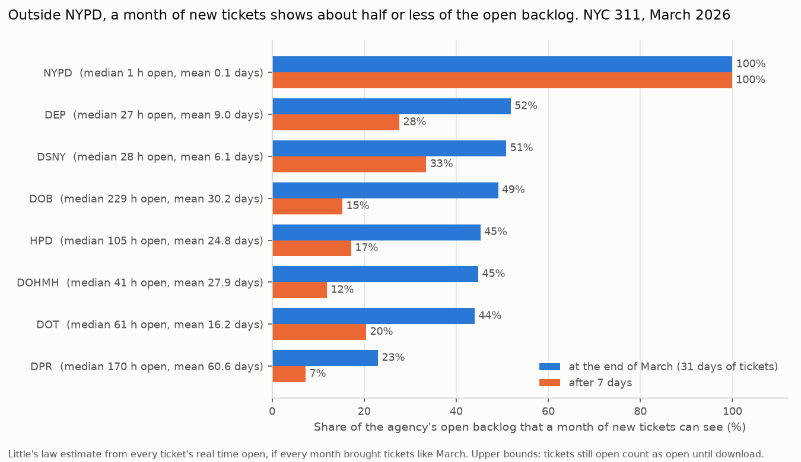
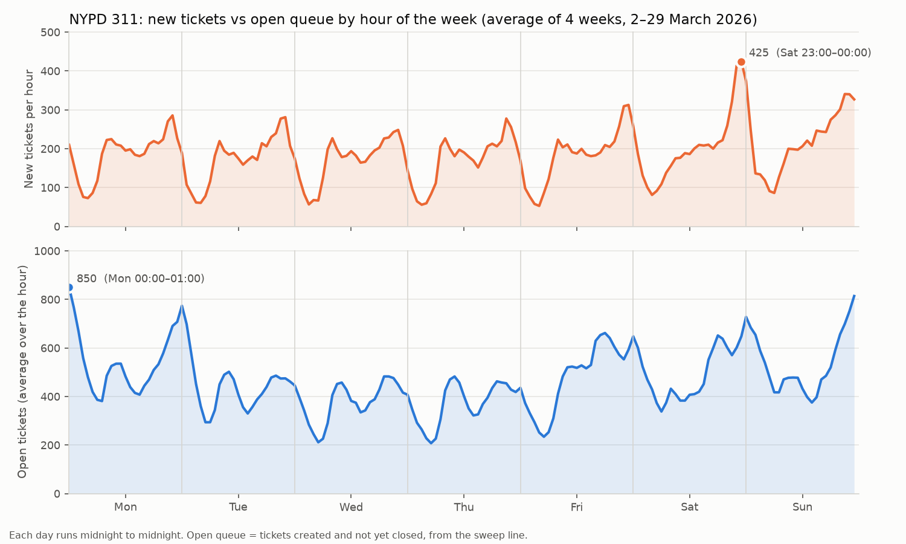

# Open backlog in NYC 311, March 2026

Open backlog = tickets created and not yet closed at a given moment. Each agency's backlog is built with a sweep line over its sorted open/close events (`dsa/backlog.py`).

## 1. Can one month of tickets show the backlog?

The data holds tickets *created* in March, so tickets still open from earlier months are missing. *Visible* = the share of a steady backlog that is younger than the window, from every ticket's real time open: E[min(time open, window)] / E[time open] (Little's law, assuming every month brings tickets like March). Tickets still open at download (2026-10-11) count as open until then, so mean times open are lower bounds and visible shares upper bounds. *Steady backlog* = March's tickets per day × mean days open.

| Agency | Tickets | Median hours open | Mean days open | Open 7+ days | Open at download | Visible after 7 days | Visible at end of March | March tickets open at end of March | Steady backlog (est.) |
|---|---:|---:|---:|---:|---:|---:|---:|---:|---:|
| NYPD | 139,705 | 1.4 | 0.1 | 0.0% | 0.0% | 100.0% | **100.0%** | 669 | 471 |
| HPD | 74,386 | 105.1 | 24.8 | 44.0% | 4.9% | 17.2% | **45.3%** | 26,920 | 59,544 |
| DOT | 46,417 | 61.0 | 16.2 | 32.0% | 4.3% | 20.5% | **44.0%** | 10,067 | 24,307 |
| DSNY | 28,814 | 28.4 | 6.1 | 8.3% | 1.6% | 33.5% | **50.9%** | 3,107 | 5,681 |
| DEP | 17,272 | 27.1 | 9.0 | 17.9% | 1.8% | 27.7% | **51.9%** | 2,648 | 5,014 |
| DOB | 11,079 | 228.9 | 30.2 | 53.7% | 0.0% | 15.3% | **49.1%** | 5,388 | 10,781 |
| DPR | 7,652 | 169.9 | 60.6 | 50.3% | 22.4% | 7.3% | **23.0%** | 3,465 | 14,947 |
| DOHMH | 6,824 | 40.9 | 27.9 | 41.4% | 3.9% | 11.9% | **44.8%** | 2,742 | 6,137 |

Agencies with 99%+ visible after 7 days, so their backlog from 2 March on is complete: **NYPD**.

## 2. NYPD: when is the queue longest?

### Exact peak vs hourly snapshots (2–31 March)

- **Exact peak (sweep line): 1,251 open tickets at Mon 9 March 00:33.** The sweep has 247,451 steps in this window, one per second the count changed.
- Highest top-of-the-hour snapshot: 1,173 at Mon 9 March 01:00, 78 lower (6.2%). Hourly counts from the sorted lists + `bisect` match the sweep at every hour.
- In the queue at the peak: Noise - Residential 388 · Illegal Parking 335 · Noise - Street/Sidewalk 192 · Blocked Driveway 110 · Noise - Commercial 78. Median age 1.7 h.

### By hour of the week (4 full weeks, Mon 2 – Sun 29 March)

- Longest average queue: **850** open tickets, Mon 00:00–01:00. Shortest: 208, Thu 05:00–06:00 (4.1× apart).
- The 4 weeks' values for that slot: 662, 1,220, 823, 695 (week by week), so one night can move the average.
- Most new tickets: 425 per hour, Sat 23:00–00:00.
- Averaged over all days, new tickets peak at 22:00 (305/h) and the open queue at 00:00 (613).

| Hour | 00 | 01 | 02 | 03 | 04 | 05 | 06 | 07 | 08 | 09 | 10 | 11 | 12 | 13 | 14 | 15 | 16 | 17 | 18 | 19 | 20 | 21 | 22 | 23 |
|---|---:|---:|---:|---:|---:|---:|---:|---:|---:|---:|---:|---:|---:|---:|---:|---:|---:|---:|---:|---:|---:|---:|---:|---:|
| New per hour | 217 | 146 | 98 | 78 | 74 | 83 | 112 | 174 | 205 | 200 | 192 | 194 | 191 | 192 | 184 | 188 | 194 | 209 | 220 | 227 | 242 | 284 | 305 | 275 |
| Open (avg) | 613 | 552 | 484 | 416 | 362 | 317 | 306 | 346 | 440 | 473 | 480 | 468 | 433 | 408 | 388 | 402 | 461 | 486 | 521 | 547 | 552 | 554 | 564 | 580 |

### Night shift: tickets created 21:00–24:00, by day of week

| Day | Tickets per night | Mean hours open | Median hours open | Mean hours open, lowest–highest week |
|---|---:|---:|---:|---:|
| Mon | 783 | 3.19 | 1.93 | 2.91–3.69 |
| Tue | 766 | 2.09 | 1.04 | 1.73–2.38 |
| Wed | 699 | 2.06 | 1.01 | 1.94–2.16 |
| Thu | 751 | 2.25 | 1.02 | 1.87–2.83 |
| Fri | 880 | 2.37 | 1.14 | 2.28–2.54 |
| Sat | 1,160 | 2.51 | 1.00 | 2.11–2.81 |
| Sun | 1,008 | 3.32 | 1.74 | 2.98–4.12 |

### Little's law cross-check

- Average open queue over the 4 weeks (time-weighted, from the sweep): **465**.
- New tickets per hour (186.7) × mean hours open (2.50; median 1.36) = **466**.
- The two should match when the window is long and the queue isn't growing; they differ only by tickets crossing the window's edges.
