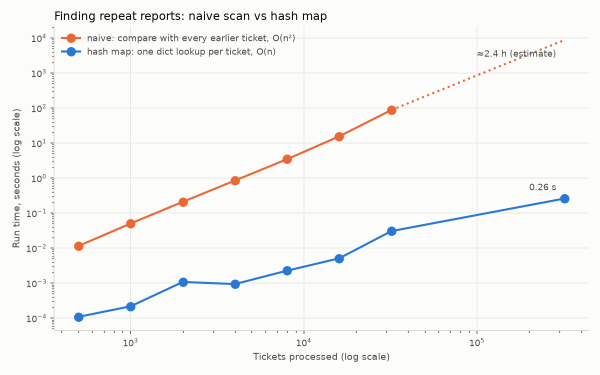

# Benchmark: naive vs hash-map repeat finder

Machine: x86_64, Python 3.12.3. Best of 5 runs for the hash map; best of 3 (1 above 4,000 tickets) for the naive version. Both versions returned identical answers at every size.

| Tickets | Naive (s) | Hash map (ms) | Speed-up | Repeats found |
|---:|---:|---:|---:|---:|
| 500 | 0.012 | 0.1 | 105× | 55 |
| 1,000 | 0.051 | 0.2 | 232× | 121 |
| 2,000 | 0.211 | 1.1 | 195× | 229 |
| 4,000 | 0.852 | 0.9 | 905× | 494 |
| 8,000 | 3.476 | 2.3 | 1,530× | 1,046 |
| 16,000 | 15.591 | 5.1 | 3,046× | 2,469 |
| 32,000 | 88.101 | 30.6 | 2,875× | 5,768 |
| 319,508 | not run | 261.0 |  | 72,098 |

- Naive run time grows as about n^2.16 (fitted from 2,000 tickets up): doubling the tickets roughly quadruples the time. The hash map grows about linearly.
- All 319,508 tickets with an address: the hash map takes **0.26 s**. The naive version would take about **2.4 hours** (extrapolated from the 32,000-ticket run as n², not run).

