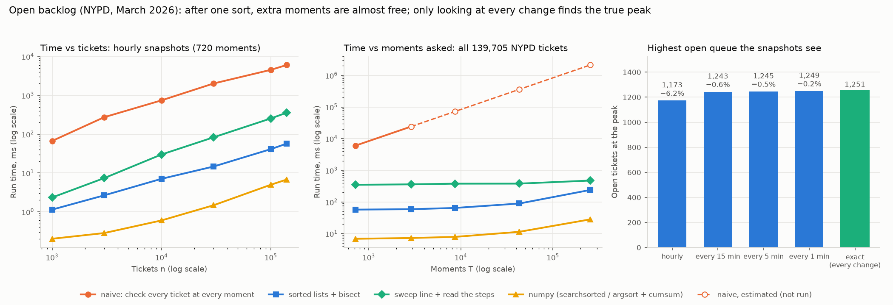

# Benchmark: counting the open backlog

Machine: x86_64, Python 3.12.3, numpy 2.5.4. Time is the best of 5 runs (1 run for the naive version). This VM is shared, so single timings can be up to 2× slower than the best. Every version returned identical counts at every moment in every row, or the script would have stopped.

Data: NYPD tickets created in March 2026; moments asked about are in 2 March 00:00 – 1 April 00:00, as in [`backlog.md`](backlog.md).

- **naive**: `backlog_naive`, check every ticket at every moment
- **bisect**: `backlog_bisect`, sorted created and closed times + two binary searches per moment
- **sweep**: `backlog_sweep` (sort all open/close events, one pass) + `backlog_at` to read the moments
- **numpy**: `np.searchsorted` on sorted arrays (the bisect idea); for the exact peak, `argsort` + `cumsum` (the sweep idea). Its time starts from int64 arrays that are already built; the others start from a list of `(created, closed)` pairs.

## 1. Varying the number of tickets (hourly snapshots, 720 moments)

Seeded random samples (seed 7) of NYPD's tickets, kept in time order.

| Tickets | naive (ms) | bisect (ms) | sweep (ms) | numpy (ms) | naive ÷ bisect |
|---:|---:|---:|---:|---:|---:|
| 1,000 | 66.8 | 1.1 | 2.3 | 0.2 | 59× |
| 3,000 | 273.7 | 2.7 | 7.4 | 0.3 | 103× |
| 10,000 | 741.6 | 7.1 | 29.9 | 0.6 | 105× |
| 30,000 | 2,020.7 | 14.7 | 83.0 | 1.5 | 138× |
| 100,000 | 4,535.8 | 41.1 | 253.9 | 5.0 | 110× |
| 139,705 | 6,045.7 | 57.0 | 357.3 | 6.8 | 106× |

## 2. Varying how often you look (all 139,705 NYPD tickets)

"Every change" asks about the window's start plus every second in it when a ticket opens or closes, so it sees every value the count takes: the exact peak. Building that list of moments (`change_times`: collect and sort the event times) took 105.5 ms and isn't included in the bisect, numpy or naive times in that row: you have to sort the events to know when to look, which is the sweep's work.

| Look every | Moments | naive | bisect | sweep | numpy | Peak seen | When | Missed vs exact |
|---|---:|---:|---:|---:|---:|---:|---|---:|
| 1 h | 720 | 6.0 s | 57.3 ms | 348.3 ms | 6.9 ms | 1,173 | Mon 9 March 01:00 | 78 (6.2%) |
| 15 min | 2,880 | 24.1 s | 59.0 ms | 359.9 ms | 7.3 ms | 1,243 | Mon 9 March 00:30 | 8 (0.6%) |
| 5 min | 8,640 | 72.2 s (est., not run) | 64.6 ms | 378.4 ms | 7.9 ms | 1,245 | Mon 9 March 00:35 | 6 (0.5%) |
| 1 min | 43,200 | 361.2 s (est., not run) | 89.2 ms | 379.6 ms | 11.4 ms | 1,249 | Mon 9 March 00:33 | 2 (0.2%) |
| every change | 254,272 | 2,126.2 s (est., not run) | 239.2 ms | 474.3 ms | 28.2 ms | 1,251 | Mon 9 March 00:33 | 0 (0.0%) |

The naive estimates scale the largest measured naive run by moments asked (its work is exactly tickets × moments). The exact peak from the sweep's steps directly (`backlog_sweep`, 255,996 steps): 334.6 ms; from `sweep_numpy`: 21.2 ms. Both give the same peak and moment as the every-change row, and the numpy steps equal `backlog_sweep`'s exactly.

## Summary

- **Hourly view, all 139,705 tickets:** naive 6.0 s, bisect 57.0 ms, sweep 357.3 ms, numpy 6.8 ms.
- **Exact peak:** 1,251 open at Mon 9 March 00:33. Hourly snapshots saw 1,173 (6.2% lower).
- **Naive at every change (254,272 moments):** about 35 minutes (estimated, not run) vs 239.2 ms for bisect.

