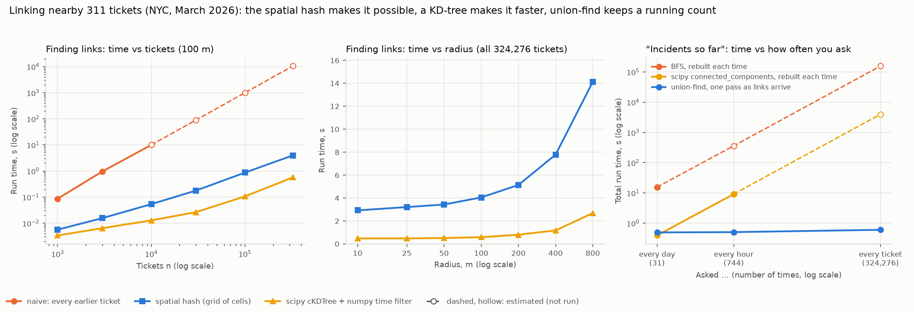

# Benchmark: linking nearby tickets and grouping them into incidents

Machine: x86_64, Python 3.12.3, numpy 2.5.4, scipy 1.18.1. Time is the best of 3 runs (1 run for the naive version and for the daily BFS loop). This VM is shared, so single timings can be up to 2× slower than the best. Every link finder returned identical links, and every grouper identical incidents, in every row, or the script would have stopped.

Data: all 324,276 tickets created in March 2026 that have coordinates, across 176 agency + complaint-type pairs (links only join tickets of the same type), in created order. Rule as in [`incidents.md`](incidents.md): same type, within the radius, earlier ticket still open.

- **naive**: `links_naive`, compare every ticket with every earlier ticket
- **grid**: `links_grid`, a dict of radius-sized cells; each ticket checks 9 cells, closed tickets are dropped from their cell
- **kdtree**: one scipy `cKDTree` per type, `query_pairs` for every pair within the radius, then a numpy filter for the open rule. Its time starts from arrays that are already built; the others start from a list of tuples. *Spatial pairs checked* is how many pairs it had to collect before the time filter
- **union-find** (`incidents`), **BFS** (`incidents_bfs`), **scipy** (`connected_components` on a sparse matrix): group links into incidents

## 1. Finding links, varying the number of tickets (100 m)

Seeded random samples (seed 11), kept in time order. Fewer tickets also means fewer links per ticket, because a sample is a thinner map.

| Tickets | Links | naive | grid | kdtree | naive ÷ grid | grid ÷ kdtree |
|---:|---:|---:|---:|---:|---:|---:|
| 1,000 | 4 | 86 ms | 6 ms | 3 ms | 15× | 1.7× |
| 3,000 | 40 | 957 ms | 16 ms | 6 ms | 62× | 2.4× |
| 10,000 | 524 | 10.0 s | 54 ms | 13 ms | 186× | 4.2× |
| 30,000 | 4,341 | 89.9 s (est., not run) | 178 ms | 26 ms | 506× | 6.7× |
| 100,000 | 48,107 | 17 min (est., not run) | 867 ms | 106 ms | 1,152× | 8.2× |
| 324,276 | 487,465 | 2.9 h (est., not run) | 4.0 s | 568 ms | 2,655× | 7.0× |

Naive estimates scale the largest measured naive run by n(n − 1)/2, the exact number of comparisons it makes.

## 2. Varying the radius (all 324,276 tickets)

| Radius | Links | Spatial pairs checked (kdtree) | Pairs ÷ links | grid | kdtree | union-find | BFS | scipy | Incidents |
|---:|---:|---:|---:|---:|---:|---:|---:|---:|---:|
| 10 m | 360,269 | 3,524,370 | 9.8× | 2.9 s | 484 ms | 390 ms | 820 ms | 37 ms | 250,117 |
| 25 m | 379,745 | 3,651,567 | 9.6× | 3.2 s | 484 ms | 429 ms | 839 ms | 40 ms | 245,147 |
| 50 m | 399,801 | 3,844,263 | 9.6× | 3.4 s | 518 ms | 464 ms | 917 ms | 41 ms | 238,749 |
| 100 m | 487,465 | 4,497,100 | 9.2× | 4.1 s | 591 ms | 534 ms | 982 ms | 49 ms | 221,364 |
| 200 m | 704,202 | 6,116,489 | 8.7× | 5.1 s | 807 ms | 681 ms | 1.1 s | 64 ms | 193,436 |
| 400 m | 1,310,255 | 10,874,516 | 8.3× | 7.8 s | 1.2 s | 1.1 s | 1.4 s | 106 ms | 153,082 |
| 800 m | 3,034,761 | 25,333,733 | 8.3× | 14.1 s | 2.7 s | 2.0 s | 2.5 s | 235 ms | 101,106 |

## 3. "Incidents so far", asked again and again (100 m, all tickets)

The question a live dashboard keeps asking. Union-find answers any number of cut-offs in one pass over the links (`incident_counts`: each successful union merges two incidents, so incidents = tickets − merges so far). BFS and scipy keep no running state, so each time they rebuild the graph of the tickets so far. Linking isn't included (the grid finds links as tickets arrive, so it suits this setting too). Rebuild versions run while their estimate stays under 40 s; above that, the time is estimated as linear in the work (tickets + links summed over every cut-off), calibrated on that version's largest measured run.

| Asked | Times | union-find | scipy, rebuilt | BFS, rebuilt |
|---|---:|---:|---:|---:|
| every day | 31 | 493 ms | 390 ms | 15.5 s |
| every hour | 744 | 504 ms | 9.1 s | 6 min (est., not run) |
| every ticket | 324,276 | 601 ms | 1.1 h (est., not run) | 43.6 h (est., not run) |

Every version that ran gave the same count at every cut-off. Daily: 7,052 incidents from 8,875 tickets at the end of 1 March, 221,364 from 324,276 at the end of 31 March (daily counts in the CSV).

## Summary

- **All 324,276 tickets at 100 m:** naive about 2.9 h (estimated, not run), grid 4.0 s (12 µs per ticket), kdtree 568 ms.
- **The KD-tree collects pairs the rule throws away:** at 100 m it checked 4,497,100 spatial pairs to keep 487,465 links (9.2×).
- **Grouping at 100 m (one run):** union-find 534 ms, BFS 982 ms, scipy 49 ms.
- **Incidents so far, asked every day (31×):** union-find 493 ms, scipy rebuilt 390 ms. **Asked every ticket (324,276×):** union-find 601 ms, scipy rebuilt about 1.1 h (estimated, not run).

