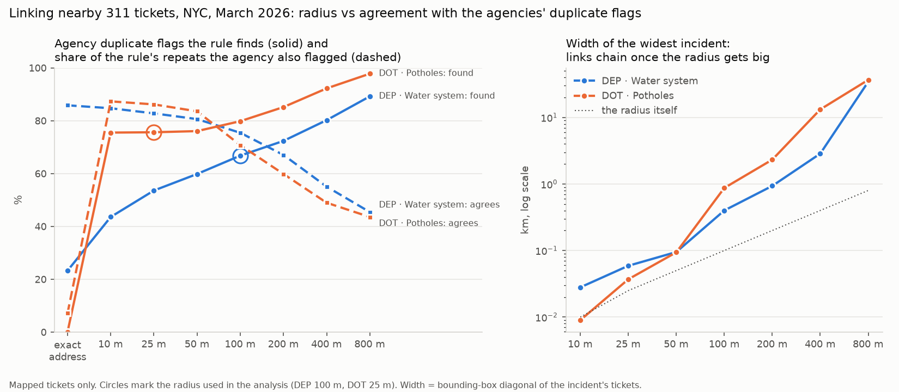

# One incident, many reports: nearby-ticket linking, NYC 311, March 2026

Two tickets are **linked** when they have the same agency and complaint type, are within the radius of each other, and the earlier one was still open when the later one came in. A ticket with at least one link is a **repeat**. Linked tickets are joined into **incidents** with union-find. Distances use the ticket coordinates (`dsa/incidents.py`: spatial hash with cells as wide as the radius).

Recall = share of the agency's duplicate flags (on mapped tickets) that the rule also marks as repeats. Precision = share of the rule's repeats that the agency also flagged. The flags are a reference, not ground truth.

## DEP · Water system

- Tickets: 5,463; with coordinates: **5,378 (98.4%)**. Agency duplicate flags: 2,247; on mapped tickets: 2,189 (97.4%).
- Mapped tickets with no street address (located by coordinates only): 881. Part 1 couldn't match these at all.
- Working radius **100 m**: water spreads: a main break or a running hydrant is seen and reported from along the block, so 100 m (about one short block). The sweep below shows the trade-off at every radius.

### Radius sweep

| Rule | Repeats | Recall | Precision | Incidents | Multi-report incidents | Largest incident (tickets) | Its width (m) | Widest incident (m) |
|---|---:|---:|---:|---:|---:|---:|---:|---:|
| exact address (Part 1) | 593 | 23.3% | 85.8% |  |  |  |  |  |
| within 10 m | 1,126 | 43.6% | 84.7% | 4,244 | 531 | 40 | 0 | 28 |
| within 25 m | 1,417 | 53.6% | 82.8% | 3,953 | 589 | 47 | 22 | 59 |
| within 50 m | 1,625 | 59.8% | 80.6% | 3,744 | 627 | 49 | 43 | 95 |
| **within 100 m** | 1,938 | 66.8% | 75.4% | 3,422 | 681 | 52 | 123 | 400 |
| within 200 m | 2,362 | 72.4% | 67.1% | 2,978 | 726 | 65 | 684 | 936 |
| within 400 m | 3,190 | 80.2% | 55.0% | 2,058 | 602 | 84 | 2,173 | 2,860 |
| within 800 m | 4,299 | 89.2% | 45.4% | 821 | 172 | 2,958 | 34,450 | 34,450 |
| within 10 m + 24 h grace | 1,486 | 56.4% | 83.0% | 3,878 | 685 | 40 | 0 | 28 |
| within 25 m + 24 h grace | 1,758 | 64.8% | 80.7% | 3,603 | 707 | 47 | 22 | 95 |
| within 50 m + 24 h grace | 1,968 | 70.7% | 78.7% | 3,388 | 731 | 50 | 82 | 173 |
| within 100 m + 24 h grace | 2,286 | 76.5% | 73.3% | 3,060 | 758 | 53 | 215 | 462 |
| within 200 m + 24 h grace | 2,712 | 81.1% | 65.5% | 2,620 | 796 | 66 | 761 | 936 |
| within 400 m + 24 h grace | 3,548 | 87.5% | 54.0% | 1,688 | 642 | 84 | 2,173 | 3,173 |
| within 800 m + 24 h grace | 4,615 | 94.7% | 44.9% | 478 | 159 | 3,143 | 34,701 | 34,701 |

At 100 m the rule finds 66.8% of the agency's flags on mapped tickets, vs 23.3% for the exact-address rule, at 75.4% precision (exact address: 85.8%). Adding a 24-hour grace period moves that to 76.5% recall at 73.3% precision.

### Flags the 100 m rule misses (727)

| Nearest earlier mapped ticket of the same type | Flags |
|---|---:|
| earlier ticket within 100 m had closed less than 24 h before | 213 |
| earlier ticket within 100 m had closed 24 h or more before | 201 |
| nearest earlier ticket 100–400 m away | 180 |
| nearest earlier ticket 400 m–1 km away | 90 |
| nearest earlier ticket over 1 km away | 43 |

A flag can also point at an earlier ticket this scope can't see: one with no coordinates, of another complaint type, or created before March.

### Repeats the agency didn't flag (476)

Most common resolution texts (first 90 characters):

| Tickets | Resolution text starts with |
|---:|---|
| 207 | The Department of Environmental Protection investigated this complaint and found it to be… |
| 138 | The Department of Environment Protection inspected your complaint but could not find the p… |
| 26 | The Department of Environmental Protection investigated this complaint and repaired or rep… |
| 25 | The Department of Environmental Protection investigated this complaint and shut the runnin… |
| 19 | The Department of Environmental Protection has inspected your complaint and determined tha… |

### Incidents at 100 m

- 5,378 mapped tickets → **3,422 incidents** (36.4% fewer). 681 incidents have 2+ reports; they hold 2,637 tickets (49.0%).
- Reports per multi-report incident: median 2, 90th percentile 7, max 52. Width: median 17 m, max 400 m.

Largest 5 incidents (borough and ZIP only; no addresses):

| Where | Tickets | Agency flags | No address | Width (m) | First report | Last report | Reported as |
|---|---:|---:|---:|---:|---|---|---|
| Brooklyn 11207 | 52 | 50 | 40 | 123 | Mon 09 Mar 11:27 | Wed 18 Mar 07:34 | Hydrant Running Full 38, Hydrant Running 5, Hydrant Defective 4 |
| Queens 11428 | 35 | 30 | 16 | 245 | Sun 08 Mar 13:49 | Fri 27 Mar 07:46 | Leak 18, Possible Water Main Break 15, No Water 2 |
| Brooklyn 11214 | 32 | 30 | 1 | 106 | Sat 28 Mar 08:12 | Tue 31 Mar 22:07 | Leak 17, Possible Water Main Break 15 |
| Brooklyn 11229 | 27 | 23 | 0 | 24 | Tue 10 Mar 11:12 | Fri 27 Mar 12:39 | Hydrant Running 12, Hydrant Defective 7, Hydrant Leaking 6 |
| Brooklyn 11230 | 27 | 23 | 11 | 259 | Thu 19 Mar 08:21 | Mon 30 Mar 18:37 | Leak 14, Possible Water Main Break 11, Dirty Water 1 |

## DOT · Potholes

- Tickets: 22,790; with coordinates: **9,554 (41.9%)**. Agency duplicate flags: 9,786; on mapped tickets: 3,916 (40.0%).
- Mapped tickets with no street address (located by coordinates only): 8,820. Part 1 couldn't match these at all.
- Working radius **25 m**: a pothole is a point, and two potholes on one block are two repairs, so 25 m (about the width of a road). The sweep below shows the trade-off at every radius.

### Radius sweep

| Rule | Repeats | Recall | Precision | Incidents | Multi-report incidents | Largest incident (tickets) | Its width (m) | Widest incident (m) |
|---|---:|---:|---:|---:|---:|---:|---:|---:|
| exact address (Part 1) | 42 | 0.1% | 7.1% |  |  |  |  |  |
| within 10 m | 3,386 | 75.5% | 87.3% | 6,168 | 1,525 | 41 | 0 | 9 |
| **within 25 m** | 3,437 | 75.6% | 86.2% | 6,117 | 1,552 | 41 | 0 | 37 |
| within 50 m | 3,565 | 76.1% | 83.6% | 5,985 | 1,599 | 41 | 0 | 94 |
| within 100 m | 4,418 | 79.8% | 70.8% | 5,060 | 1,630 | 64 | 318 | 872 |
| within 200 m | 5,572 | 85.2% | 59.9% | 3,775 | 1,462 | 87 | 2,322 | 2,322 |
| within 400 m | 7,377 | 92.2% | 49.0% | 1,741 | 728 | 1,162 | 13,212 | 13,212 |
| within 800 m | 8,790 | 97.8% | 43.6% | 400 | 149 | 4,883 | 36,712 | 36,712 |
| within 10 m + 24 h grace | 3,618 | 78.3% | 84.7% | 5,936 | 1,575 | 41 | 0 | 9 |
| within 25 m + 24 h grace | 3,673 | 78.4% | 83.6% | 5,881 | 1,602 | 41 | 0 | 37 |
| within 50 m + 24 h grace | 3,806 | 78.9% | 81.2% | 5,744 | 1,652 | 41 | 0 | 94 |
| within 100 m + 24 h grace | 4,659 | 82.5% | 69.3% | 4,814 | 1,667 | 64 | 318 | 872 |
| within 200 m + 24 h grace | 5,846 | 87.6% | 58.7% | 3,489 | 1,472 | 91 | 2,322 | 2,322 |
| within 400 m + 24 h grace | 7,627 | 94.0% | 48.2% | 1,445 | 667 | 1,382 | 13,671 | 13,671 |
| within 800 m + 24 h grace | 8,938 | 98.4% | 43.1% | 254 | 109 | 4,981 | 37,066 | 37,066 |

At 25 m the rule finds 75.6% of the agency's flags on mapped tickets, vs 0.1% for the exact-address rule, at 86.2% precision (exact address: 7.1%). Adding a 24-hour grace period moves that to 78.4% recall at 83.6% precision.

### Flags the 25 m rule misses (954)

| Nearest earlier mapped ticket of the same type | Flags |
|---|---:|
| nearest earlier ticket 25–400 m away | 496 |
| earlier ticket within 25 m had closed 24 h or more before | 208 |
| earlier ticket within 25 m had closed less than 24 h before | 110 |
| nearest earlier ticket 400 m–1 km away | 110 |
| nearest earlier ticket over 1 km away | 30 |

A flag can also point at an earlier ticket this scope can't see: one with no coordinates, of another complaint type, or created before March.

### Repeats the agency didn't flag (475)

Most common resolution texts (first 90 characters):

| Tickets | Resolution text starts with |
|---:|---|
| 330 | The Department of Transportation inspected this complaint and repaired the problem.… |
| 45 | The Department of Transportation inspected this complaint and did not find the reported pr… |
| 25 | The Department of Transportation referred this complaint to the appropriate Maintenance Un… |
| 21 | The Department of Transportation referred this complaint to the Inspections Unit for furth… |
| 19 | The status of this Service Request is currently not available online. Please call 311 for… |

### Incidents at 25 m

- 9,554 mapped tickets → **6,117 incidents** (36.0% fewer). 1,552 incidents have 2+ reports; they hold 4,989 tickets (52.2%).
- Reports per multi-report incident: median 2, 90th percentile 5, max 41. Width: median 0 m, max 37 m.

Largest 5 incidents (borough and ZIP only; no addresses):

| Where | Tickets | Agency flags | No address | Width (m) | First report | Last report | Reported as |
|---|---:|---:|---:|---:|---|---|---|
| Manhattan 10023 | 41 | 38 | 41 | 0 | Thu 12 Mar 21:03 | Tue 31 Mar 14:37 | Pothole 41 |
| Manhattan 10065 | 36 | 33 | 36 | 0 | Mon 16 Mar 14:43 | Tue 31 Mar 16:45 | Pothole 36 |
| Manhattan 10025 | 24 | 21 | 23 | 13 | Wed 04 Mar 08:39 | Fri 20 Mar 15:56 | Pothole 24 |
| Bronx 10472 | 23 | 22 | 23 | 0 | Mon 09 Mar 13:22 | Sun 29 Mar 12:00 | Pothole 23 |
| Queens 11102 | 22 | 13 | 3 | 0 | Tue 03 Mar 07:52 | Wed 25 Mar 14:59 | Pothole 22 |

## Chart

Full sweep: [`incidents_sweep.csv`](incidents_sweep.csv).
